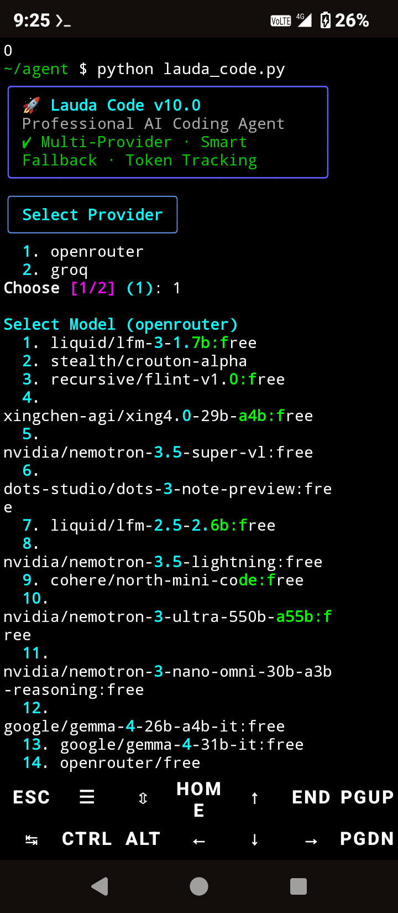

# 🚀 Lauda Code

**Lauda Code** is a powerful, terminal-based AI coding agent designed to write code, debug, and execute commands directly on your device. It supports multiple AI providers, smart fallback, and includes both a rich Terminal UI and a Web interface.



---

## ✨ Features

- **Multi-Provider Support:** Works seamlessly with OpenRouter, Groq, Cerebras, Mistral, and Gemini.
- **Smart Fallback:** If one provider is rate-limited or fails, it automatically switches to the next available model.
- **Autopilot Mode:** Let the AI continuously review and fix its own code.
- **Web UI Mode:** Run the tool in your browser using the `/web` command.
- **Sandboxed Tools:** The AI can create folders, read/write files, and execute terminal commands safely.
- **Token Tracking:** Keep track of your session token usage.

---

## 📦 Installation

### For Termux / Linux / macOS

You can install Lauda Code automatically using the setup script. This script checks for dependencies, installs them, creates shortcuts, and cleans up unnecessary files.

**Run this command in your terminal:**

```bash
curl -fsSL https://raw.githubusercontent.com/ERROR0101r/lauda-code/main/install.sh | bash
```

Or, if you have the repository cloned locally:

```bash
chmod +x install.sh
./install.sh
```

Manual Installation (Python)

If you prefer to run it manually, ensure you have the required dependencies:

```bash
pkg install python -y  # For Termux users
pip install requests rich
python lauda_code.py
```

---

🛠️ Usage

Once installed, you can launch the tool from anywhere in your terminal by typing:

```bash
lauda
```

Terminal Commands

Once inside the Lauda Code prompt (❯), you can use the following commands:

Command Description
/web Starts the Web UI on http://localhost:8080
/provider Change your active AI Provider or Model
/keys View the status of your API keys
/autopilot Toggle Auto-Pilot mode (AI self-reviews code)
/status Check current provider, model, and session tokens
/clear Clear the conversation context
/session save Save your current chat session
/session load Load a previously saved session
/reset Delete your API config
!<command> Execute a raw terminal command directly (e.g., !ls)
exit Quit the tool

---

⚠️ Disclaimer

Lauda Code uses an AI agent that can execute terminal commands and modify files on your device. Always review the AI's actions, especially when using the execute_command tool. Use at your own risk.

---

👨‍💻 Developed By

ERROR

· Telegram: https://t.me/aab_ho_ga_comeback
· GitHub: ERROR0101r

---

📄 License

This project is licensed under the Lauda Attribution License (LAL) v1.0.

You are free to use, modify, and distribute this software (even commercially), provided that you keep credit to the original developer.

See the LICENSE file for full details.
